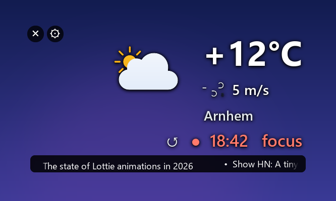

# Desk Widget

A transparent desktop widget for Windows: animated weather for your city, a pomodoro timer and a
Hacker News ticker. It sits on the desktop under your open windows, like a gadget.



- **Weather** from [MET Norway](https://api.met.no/) (the API behind [yr.no](https://www.yr.no/)) with
  animated [Meteocons](https://github.com/basmilius/meteocons) icons and a Beaufort wind icon
- **Pomodoro**: 25 min focus, 5 min break, 15 min long break after every 4th session
- **Hacker News**: top 30 stories scrolling in a ticker; click a headline to open it
- **Any city**: pick yours on first start, change it any time
- Crisp text on high-DPI screens, soft shadows, readable on dark and light wallpapers

## Requirements

- Windows 10 or 11
- Python 3.12+

## Install

```powershell
git clone https://github.com/DmytroT-dev/weather-widget.git
cd weather-widget
py -m venv .venv
.venv\Scripts\python -m pip install -r requirements.txt
```

MET Norway asks every app to send a contact address in its User-Agent ([terms](https://api.met.no/doc/TermsOfService)).
Set yours once; it is sent to MET Norway only:

```powershell
setx WEATHER_WIDGET_CONTACT "you@example.com"
```

Run it by double-clicking `run.cmd`. On the first start the widget asks for your city.

### Start with Windows

```powershell
powershell -ExecutionPolicy Bypass -File scripts\install-autostart.ps1              # install
powershell -ExecutionPolicy Bypass -File scripts\install-autostart.ps1 -Uninstall   # remove
```

Only one copy runs at a time, so starting it by hand while autostart already did is harmless.

## Usage

| Action | How |
|---|---|
| Move the widget | drag it anywhere with the left mouse button (the position is remembered) |
| Settings menu | hover the widget and click ⚙, or right-click it |
| Change city | ⚙ → Change city… |
| Keep it above other windows | ⚙ → Always on top |
| Start / pause the timer | click the timer |
| Reset the timer | click ↺ (or double-click the timer) |
| Read a headline | hover the ticker to pause it, click the headline to open it |
| Close | hover the widget and click ×, or ⚙ → Close |

Settings live in `%APPDATA%\weather-widget\state.json`; errors are logged to `widget.log` next to it.

## Privacy and security

- Your city name goes to [Open-Meteo geocoding](https://open-meteo.com/en/docs/geocoding-api) only when you search
  for it. No IP-based location lookup.
- Your contact address goes to MET Norway only; Hacker News and Open-Meteo get an anonymous User-Agent.
- Everything from the network is treated as untrusted: response size and time are capped, JSON is validated
  field by field, and only plain `http(s)` links without hidden characters can be opened from the ticker.

## Development

```powershell
.venv\Scripts\python -m unittest -v
```

| Module | Responsibility |
|---|---|
| `weather/` | MET Norway client with `Expires` / `If-Modified-Since` caching, forecast parser, city search, icon mapping |
| `news/hackernews.py` | Hacker News client and story parsing |
| `focus/pomodoro.py` | pomodoro state machine with an injectable clock |
| `shared/http.py` | size- and time-limited JSON reading |
| `ui/scene.py` | layout, per-frame compositing and hit testing (no Tk, no Win32) |
| `ui/render.py`, `ui/animation.py` | Pillow text with shadows, Lottie frames via rlottie |
| `ui/layered.py` | DPI awareness and the per-pixel alpha window (`UpdateLayeredWindow`) |
| `ui/widget.py`, `ui/city_dialog.py` | Tk window, mouse, menu, background loading, city dialog |
| `main.pyw`, `config.py` | composition root and settings |

Sizes are tuned in `ui/scene.py`: `UPPER_SCALE` scales everything above the ticker.

## Credits

- Weather data: [MET Norway](https://api.met.no/), licensed under [CC BY 4.0](https://creativecommons.org/licenses/by/4.0/)
- Geocoding: [Open-Meteo](https://open-meteo.com/), [CC BY 4.0](https://creativecommons.org/licenses/by/4.0/)
- Icons: [Meteocons](https://github.com/basmilius/meteocons) by Bas Milius, MIT (`assets/meteocons/LICENSE`)
- Headlines: [Hacker News API](https://github.com/HackerNews/API)

## License

[MIT](LICENSE)
